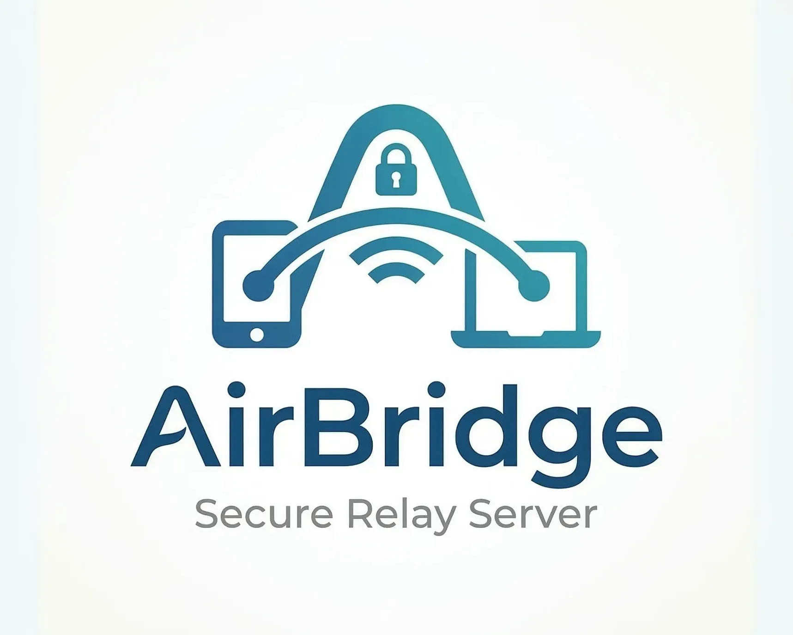

<p align="center">
  
</p>

<p align="center">
  Lightweight, high-performance, self-hosted relay server in Go for the <b>AirSync</b> ecosystem.
</p>

AirBridge acts as a secure middleman (a "dumb pipe") that allows your Android device and Mac to stay seamlessly connected even when they leave the local Wi-Fi network (e.g., when switching to 4G/5G or a different network).

## ✨ Why AirBridge
By default, AirSync works beautifully over a direct Local Area Network (LAN) connection. However, if you want a seamless "Apple-style" ecosystem experience where notifications, clipboards, and controls sync regardless of where you are, you need a bridge.

AirBridge solves this by providing a persistent WebSocket tunnel between your devices over the internet, automatically taking over when LAN is unavailable.

## 🔒 Zero-Knowledge & Security
Security is the absolute priority of this project. AirBridge is designed purely as a **"Dumb Pipe"**:
- **End-to-End Encryption (E2E):** The server **never** sees your plaintext data. All payloads are encrypted locally on your devices using a Symmetric Key (exchanged safely during the initial LAN QR-code pairing) before hitting the relay. The server cannot read the AES-encrypted data.
- **HMAC-SHA256 Challenge-Response Authentication:** The server authenticates clients using a secure 2-step handshake. The server sends a random nonce (challenge), and the client responds with an HMAC signature computed using a hashed version of your pairing secret. This completely prevents replay attacks and pass-the-hash vulnerabilities. The server keeps the session key in-memory only and never stores your actual secrets.
- **No ADB over Internet:** For strict security reasons, deep system access features like ADB and file transfers are completely forbidden over the relay. The client apps will actively drop any ADB requests coming from the internet.

## 📖 How It Works
For a detailed technical explanation of the HMAC-SHA256 authentication, the End-to-End (E2E) encryption, and the full message flow between clients and the server, please refer to the protocol documentation:

➡️ **[PROTOCOL](PROTOCOL.md)**

## 🚀 Architecture & Tech Stack
While heavier frameworks like Spring Boot were considered, **Go (Golang)** was chosen for this server.
- **Extremely Lightweight:** Uses minimal RAM and CPU, making it perfect for cheap VPS instances (like a $3/month server) or a Raspberry Pi.
- **High Concurrency:** Go's goroutines and the `gorilla/websocket` package make it exceptionally good at handling persistent, long-lived WebSocket connections simultaneously without breaking a sweat.
- **Auto-Cleanup:** Features a built-in Heartbeat Monitor that automatically prunes dead or abandoned connections to prevent memory leaks.

## 🛠 Setup & Deployment
This server is designed to be easily self-hostable using Docker.

### Running with Docker Compose (Recommended)
The easiest way to get started is using the provided `docker-compose.yml`:

```bash
# Clone the repository
git clone https://github.com/tornado-bunk/airbridge-server.git
cd airbridge-server

# Run in the background
docker compose up --build -d
```

### Running from source (Go)
```bash
# Run directly
go run ./cmd/server

# Or build the binary
go build -o airbridge ./cmd/server
./airbridge -addr :8080
```

## 🛡️ TLS / WSS Setup (Crucial for Production)
**IMPORTANT:** While the *application payloads* are End-to-End Encrypted, the WebSocket protocol metadata (like connection roles) is not. **You MUST run this server over WSS (Secure WebSocket) in production.**

### My Personal Setup
I currently run this server behind **Cloudflare** and **Nginx Proxy Manager (NPM)**, and it works flawlessly. Cloudflare provides DDoS protection and DNS routing, while NPM handles the SSL/TLS termination and proxies the WebSocket connection (`wss://`) to the internal Go container. 

*Note: Other proxy configurations (like raw Nginx, Caddy, or Traefik) should work conceptually, but they have not been actively tested by me.*

If you are using Nginx Proxy Manager with Cloudflare, I highly recommend adding the following in the **Custom Nginx Configuration** tab (Advanced section) to ensure long-lived WebSocket connections don't drop and to correctly pass the real client IPs:

```nginx
proxy_read_timeout 3600s;
proxy_send_timeout 3600s;
proxy_buffering off;
proxy_set_header CF-Connecting-IP $http_cf_connecting_ip;
proxy_set_header X-Forwarded-For $http_cf_connecting_ip;
proxy_set_header X-Forwarded-Proto $scheme;
proxy_set_header Connection "upgrade";
```

### Quick Health Check
Once running, you can test if the server is up:
```bash
curl http://localhost:8080/
```
Expected response: `Sync Relay Server is running`

---
*Disclaimer: This is a personal side-project built as an AI-aided extension of the amazing original AirSync app.*
